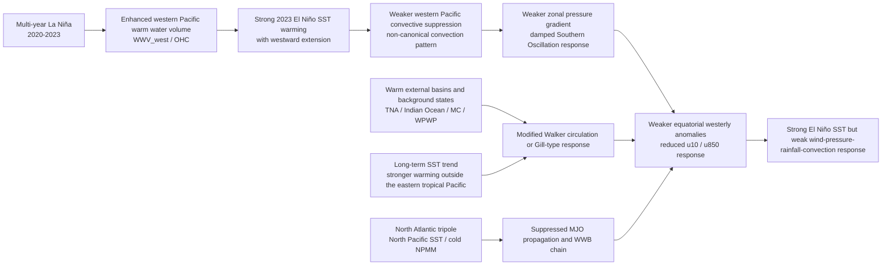
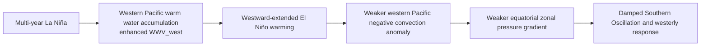
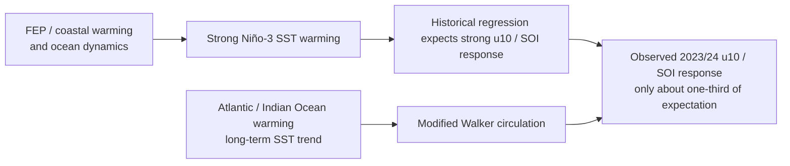
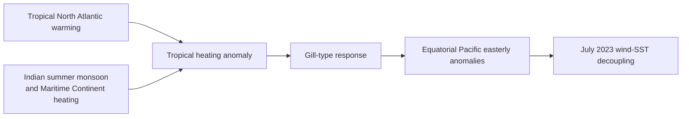
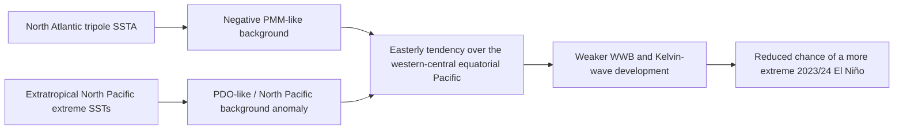
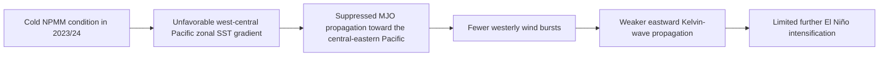
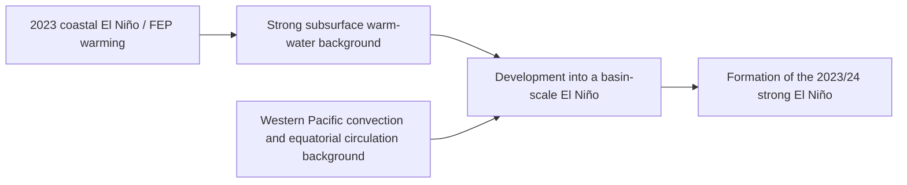
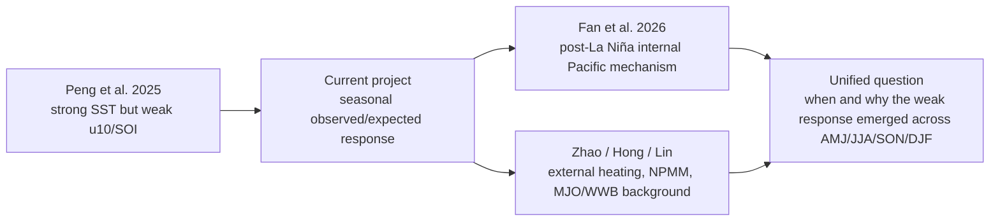

# Mechanism Flowchart Summary for the Weak Atmospheric Response During the 2023/24 El Niño

Date: 2026-06-04  
Purpose: A concise literature-based mechanism map for advisor discussion and presentation preparation.

## 1. Take-Home Message

The papers point to a common interpretation:

**The 2023/24 El Niño was not SST-weak. It was ocean-strong but atmosphere-response-weak.**

The proposed mechanisms fall into two broad groups:

- **Internal tropical Pacific mechanisms**: multi-year La Niña, enhanced western Pacific warm water volume, westward-extended El Niño warming, and displaced convection weakened the canonical pressure-wind response.
- **External and background-state mechanisms**: Atlantic, Indian Ocean, Maritime Continent, North Pacific, NPMM, MJO/WWB, and long-term SST trends may have further suppressed or offset equatorial Pacific westerly anomalies.

## 2. Integrated Mechanism Framework

## 3. Paper-by-Paper Mechanism Flows

### 3.1 Fan et al. 2026: Tropical Pacific-Rooted Dynamics After Multi-Year La Niña

**Paper**: Fan et al. 2026, *Multi-year La Niña dampens the Southern Oscillation during subsequent El Niño through tropical Pacific-rooted dynamics*  
**Link**: [The Innovation Geoscience](https://www.the-innovation.org/article/doi/10.59717/j.xinn-geo.2026.100224)

**Core mechanism**:

Fan et al. (2026) argues that the weak Southern Oscillation response during 2023/24 arose from **tropical Pacific-rooted dynamics**. The preceding multi-year La Niña built up strong western Pacific warm water volume. During the following El Niño, warming extended farther west, weakening the canonical western Pacific convective suppression and therefore damping the pressure-gradient and westerly-wind response.

**Use for the current project**:

This is the key paper for the present presentation. It explains why strong oceanic preconditioning did not translate into a strong pressure-wind response. The current project extends this idea by asking when the weak response emerged seasonally and whether wind, sea-level pressure, rainfall, and OLR weakened together.

### 3.2 Peng et al. 2025: Ocean-Dynamical Generation With Weak Atmospheric Feedback

**Paper**: Peng et al. 2025, *Strong 2023–2024 El Niño generated by ocean dynamics*  
**Link**: [Nature Geoscience](https://www.nature.com/articles/s41561-025-01700-9)

**Core mechanism**:

Peng et al. (2025) shows that the 2023/24 El Niño was strongly generated by ocean dynamics, but the atmospheric branch, especially surface winds and SOI, was much weaker than expected from historical Niño-3 SST relationships. AGCM experiments suggest that Atlantic/Indian Ocean warming and background SST trends reduced the tropical Pacific wind response.

**Use for the current project**:

This is the reproduction baseline. The current project uses its observed-versus-expected response logic, but decomposes it into AMJ/JJA/SON/DJF and extends it to rainfall and OLR.

### 3.3 Zhao, Li & Pan 2025: July 2023 External Heating and Gill-Type Response

**Paper**: Zhao, Li & Pan 2025, *Why zonal wind anomalies were “decoupled” to El Niño in July 2023*  
**Link**: [Climate Dynamics](https://link.springer.com/article/10.1007/s00382-025-07625-8)

**Core mechanism**:

This paper focuses on July 2023, when El Niño SST warming was already present but equatorial Pacific winds were easterly rather than westerly. It attributes the wind-SST decoupling to Tropical North Atlantic warming and Indian summer monsoon / Maritime Continent heating through a Gill-type atmospheric response.

**Use for the current project**:

It provides a month-scale mechanism for the JJA window. The current project can place July 2023 within a seasonal AMJ-JJA-SON-DJF framework.

### 3.4 Hong et al. 2024: North Atlantic Tripole and North Pacific Remote Forcing

**Paper**: Hong et al. 2024, *Impact of North Atlantic Tripole and Extratropical North Pacific Extreme SSTs on the 2023/24 El Niño*  
**Link**: [DOAJ](https://doaj.org/article/1d7b4ec8c21545e6af586e04fa7faf09)

**Core mechanism**:

Hong et al. (2024) emphasizes remote forcing from the North Atlantic tripole and extratropical North Pacific SST anomalies. These background states may induce easterly tendencies over the western-central equatorial Pacific and weaken the wind-burst and Kelvin-wave chain.

**Use for the current project**:

It warns that the external-basin diagnosis should not stop at TNA, Indian Ocean, and Maritime Continent. North Pacific / NPMM-related indices should be added later.

### 3.5 Lin et al. 2025: Cold NPMM, MJO, and Westerly Wind Bursts

**Paper**: Lin et al. 2025, *Diverse NPMM conditions deviate the 2023/24 El Niño from the 1997/1998 and 2015/2016 extreme El Niño events*  
**Link**: [npj Climate and Atmospheric Science](https://www.nature.com/articles/s41612-025-01013-z)

**Core mechanism**:

Lin et al. (2025) argues that although 2023/24 had strong western Pacific warm-water preconditioning, the cold NPMM background reduced MJO propagation and westerly wind bursts, thereby weakening Kelvin-wave development and limiting further El Niño intensification.

**Use for the current project**:

It supports adding NPMM, RMM/MJO, and daily wind-burst diagnostics after the seasonal response matrix is stable.

### 3.6 Tan et al. 2024: Divergent Evolution After Coastal El Niño

**Paper**: Tan et al. 2024, *On the Divergent Evolution of ENSO After the Coastal El Niños in 2017 and 2023*  
**Link**: [NOAA repository](https://repository.library.noaa.gov/view/noaa/61846)

**Core mechanism**:

Tan et al. (2024) explains why the 2017 and 2023 coastal El Niño events evolved differently. In 2023, stronger subsurface warm-water preconditioning allowed coastal warming to develop into a basin-scale El Niño.

**Use for the current project**:

It explains the early event-development background, but it is not the primary explanation for the weak atmospheric response.

## 4. Relationship Among Mechanisms

| Mechanism level | Representative paper | What it explains | How to use it in this project |
|---|---|---|---|
| Core internal Pacific mechanism | Fan et al. 2026 | Why strong post-La Niña ocean preconditioning produced a weak SO response | Main literature focus; add WWV_west and SST/OLR westward-extension metrics |
| Reproduction baseline | Peng et al. 2025 | Strong SST but u10/SOI only about one-third of expectation | Basis for observed/expected response logic |
| Summer external heating | Zhao et al. 2025 | Why July 2023 had easterly wind anomalies despite El Niño SST | JJA mechanism zoom-in |
| North Atlantic / North Pacific forcing | Hong et al. 2024 | How North Atlantic tripole and North Pacific SSTs weakened wind-burst development | Add North Pacific / NPMM branch |
| NPMM / MJO / WWB pathway | Lin et al. 2025 | How cold NPMM limited MJO and WWBs | Add daily MJO and wind-burst diagnostics later |
| Early event development | Tan et al. 2024 | Why 2023 coastal warming developed into basin-scale El Niño | Event background, not the main decoupling mechanism |

## 5. Concise Positioning for the Current Project

A concise presentation sentence:

> These studies suggest that the weak atmospheric response during the 2023/24 El Niño was unlikely to be caused by a single mechanism. Fan et al. (2026) emphasizes tropical Pacific structure after multi-year La Niña, while Peng et al. (2025) and Zhao et al. (2025) point to external-basin warming and atmospheric heating as additional suppressors of the canonical westerly response. My project uses a seasonal observed/expected response matrix to first quantify when the weak response emerged, and then compare internal Pacific structure with external background states.

## 6. Reference Links

- Fan et al. 2026, The Innovation Geoscience: [Article](https://www.the-innovation.org/article/doi/10.59717/j.xinn-geo.2026.100224)
- Peng et al. 2025, Nature Geoscience: [Article](https://www.nature.com/articles/s41561-025-01700-9)
- Zhao, Li & Pan 2025, Climate Dynamics: [Article](https://link.springer.com/article/10.1007/s00382-025-07625-8)
- Hong et al. 2024, Geophysical Research Letters: [DOAJ](https://doaj.org/article/1d7b4ec8c21545e6af586e04fa7faf09)
- Lin et al. 2025, npj Climate and Atmospheric Science: [Article](https://www.nature.com/articles/s41612-025-01013-z)
- Tan et al. 2024, Geophysical Research Letters: [NOAA repository](https://repository.library.noaa.gov/view/noaa/61846)

