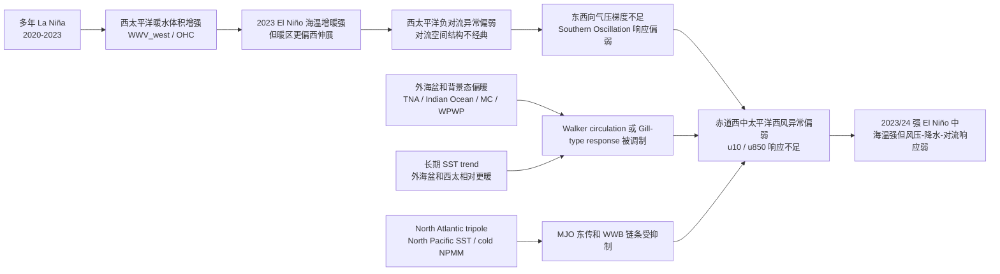
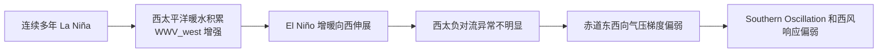
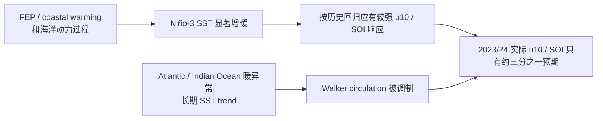
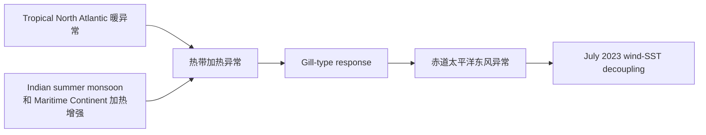
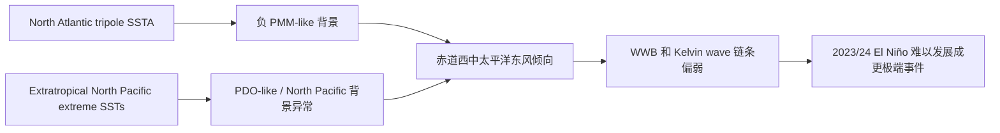
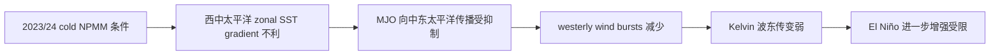
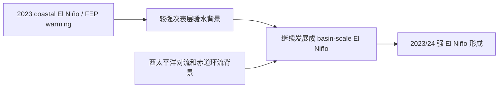
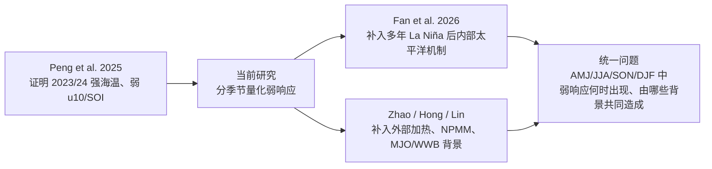

# 2023/24 El Niño 弱大气响应机制流程图总结

整理日期：2026-06-04  
用途：用于导师汇报中解释相关文献的机制关系，并衔接当前课题“分季节风压-降水-对流弱响应”主线。

## 1. 一句话总结

这些文章共同指向一个判断：

**2023/24 El Niño 不是简单的“海温不够强”，而是一个海洋端已经很强、但大气响应链条被削弱或错位的事件。**

机制上可以分成两类：

- **内部太平洋机制**：多年 La Niña 后的西太暖水、SST 暖异常向西伸展、对流位置异常，使典型 El Niño 的风压响应不够强。
- **外部/背景态机制**：Atlantic、Indian Ocean、Maritime Continent、North Pacific、NPMM、MJO/WWB 和长期 SST trend 进一步抵消或削弱赤道西风响应。

## 2. 综合机制总图

## 3. 分篇机制流程图

### 3.1 Fan et al. 2026：多年 La Niña 后的热带太平洋内部机制

**文章**：Fan et al. 2026, *Multi-year La Niña dampens the Southern Oscillation during subsequent El Niño through tropical Pacific-rooted dynamics*  
**链接**：[The Innovation Geoscience](https://www.the-innovation.org/article/doi/10.59717/j.xinn-geo.2026.100224)

**机制核心**：

Fan et al. 2026 认为，2023/24 的弱 Southern Oscillation response 主要来自 **tropical Pacific-rooted dynamics**。多年 La Niña 之后，西太暖水预条件很强，但这也使 2023 年的 El Niño 暖异常更偏西伸展，削弱了经典 El Niño 中西太平洋对流受抑制和东西向气压梯度增强的过程。

**对当前课题的作用**：

这是最贴近当前 PPT 的核心文献。它解释“为什么海洋端强但气压/风场响应弱”，而当前研究可以进一步回答：这种弱响应在 AMJ、JJA、SON、DJF 中何时开始，并是否同时表现在风、SLP、降水和 OLR 上。

### 3.2 Peng et al. 2025：强 El Niño 由海洋动力生成，但大气反馈偏弱

**文章**：Peng et al. 2025, *Strong 2023–2024 El Niño generated by ocean dynamics*  
**链接**：[Nature Geoscience](https://www.nature.com/articles/s41561-025-01700-9)

**机制核心**：

Peng et al. 2025 证明 2023/24 El Niño 的海洋端很强，但赤道风场和 SOI 响应显著偏弱。文章还通过 AGCM 实验指出，Atlantic、Indian Ocean 增暖和长期背景 SST trend 可能削弱热带太平洋表面风响应。

**对当前课题的作用**：

它是原文复现和研究问题的基线。当前课题沿用其 observed / expected response 思路，但把事件尺度拆成 AMJ/JJA/SON/DJF，并扩展到降水和 OLR。

### 3.3 Zhao, Li & Pan 2025：July 2023 的外部加热和 Gill-type response

**文章**：Zhao, Li & Pan 2025, *Why zonal wind anomalies were “decoupled” to El Niño in July 2023*  
**链接**：[Climate Dynamics](https://link.springer.com/article/10.1007/s00382-025-07625-8)

**机制核心**：

这篇文章聚焦 2023 年 7 月，解释为什么 El Niño 暖海温已经出现，但赤道太平洋并没有形成典型西风异常，反而出现东风异常。作者认为 TNA 暖异常和 ISM/MC 加热可通过 Gill-type response 诱发赤道太平洋东风。

**对当前课题的作用**：

它可以作为 JJA 机制放大图的文献支撑。当前研究可以把 July 2023 放在 JJA 季节窗口内，说明单月脱耦可能是发展季风压响应不足的一部分。

### 3.4 Hong et al. 2024：North Atlantic tripole 和 North Pacific SST 遥强迫

**文章**：Hong et al. 2024, *Impact of North Atlantic Tripole and Extratropical North Pacific Extreme SSTs on the 2023/24 El Niño*  
**链接**：[DOAJ](https://doaj.org/article/1d7b4ec8c21545e6af586e04fa7faf09)

**机制核心**：

这篇文章强调北大西洋三极型海温异常和北太平洋极端 SST 对赤道太平洋风场的遥相关影响。它们可能诱发赤道西中太平洋东风倾向，削弱 westerly wind bursts 和 Kelvin 波链条。

**对当前课题的作用**：

它提醒后续不能只看 TNA、TIO 和 Maritime Continent，还应补 North Pacific / NPMM 相关背景态。

### 3.5 Lin et al. 2025：cold NPMM 抑制 MJO / WWB 链条

**文章**：Lin et al. 2025, *Diverse NPMM conditions deviate the 2023/24 El Niño from the 1997/1998 and 2015/2016 extreme El Niño events*  
**链接**：[npj Climate and Atmospheric Science](https://www.nature.com/articles/s41612-025-01013-z)

**机制核心**：

Lin et al. 2025 认为，2023/24 虽然有较强西太暖水预条件，但 cold NPMM 背景不利于 MJO 传播和 WWB 发展，因此限制了 El Niño 进一步增强。

**对当前课题的作用**：

它与 Fan et al. 2026 都强调内部太平洋结构和风爆发链条，但 Lin 更关注 NPMM、MJO 和 WWB。后续可以作为日尺度风爆发和 RMM/MJO 指标的依据。

### 3.6 Tan et al. 2024：coastal El Niño 后的不同演变路径

**文章**：Tan et al. 2024, *On the Divergent Evolution of ENSO After the Coastal El Niños in 2017 and 2023*  
**链接**：[NOAA repository](https://repository.library.noaa.gov/view/noaa/61846)

**机制核心**：

Tan et al. 2024 解释为什么 2017 和 2023 两次 coastal El Niño 后续发展不同。2023 年由于次表层暖水背景更强，沿岸暖事件继续发展为 basin-scale El Niño。

**对当前课题的作用**：

它主要解释 2023 年为什么能发展起来，而不是直接解释弱大气响应。适合放在“事件发展背景”部分，而不是核心脱耦机制部分。

## 4. 机制之间的关系

| 机制层级 | 代表文献 | 解释对象 | 当前课题中应如何使用 |
|---|---|---|---|
| 核心内部机制 | Fan et al. 2026 | 多年 La Niña 后强海洋预条件为何对应弱 SO response | 汇报重点；补 WWV_west、SST/OLR westward extension |
| 原文基线 | Peng et al. 2025 | 2023/24 海温强但 u10/SOI 约三分之一预期 | 复现基础；分季节 observed/expected response 的来源 |
| 夏季外部加热 | Zhao et al. 2025 | July 2023 为什么出现东风异常 | JJA 机制放大图 |
| 北大西洋/北太平洋遥强迫 | Hong et al. 2024 | North Atlantic tripole、North Pacific SST 如何削弱风爆发链条 | 补 North Pacific / NPMM 分支 |
| NPMM/MJO/WWB | Lin et al. 2025 | cold NPMM 如何限制 WWB 和 Kelvin 波 | 后续日尺度和风爆发诊断 |
| 早期发展路径 | Tan et al. 2024 | coastal El Niño 如何发展成 basin-scale El Niño | 事件背景，不作为脱耦主因 |

## 5. 对当前课题的最简结论

目前最稳妥的课题逻辑是：

汇报时可以说：

> 这些文献说明，2023/24 El Niño 的弱大气响应很可能不是单一原因导致。Fan et al. 2026 强调多年 La Niña 后的热带太平洋内部结构，Peng et al. 2025 和 Zhao et al. 2025 则提示外海盆和背景增暖也能削弱西风响应。我的研究计划是在这个基础上，用 AMJ/JJA/SON/DJF 的 observed / expected response 矩阵，先量化弱响应何时出现，再比较内部太平洋结构和外部背景态是否同步增强。

## 6. 参考文献链接

- Fan et al. 2026, The Innovation Geoscience: [Article](https://www.the-innovation.org/article/doi/10.59717/j.xinn-geo.2026.100224)
- Peng et al. 2025, Nature Geoscience: [Article](https://www.nature.com/articles/s41561-025-01700-9)
- Zhao, Li & Pan 2025, Climate Dynamics: [Article](https://link.springer.com/article/10.1007/s00382-025-07625-8)
- Hong et al. 2024, Geophysical Research Letters: [DOAJ](https://doaj.org/article/1d7b4ec8c21545e6af586e04fa7faf09)
- Lin et al. 2025, npj Climate and Atmospheric Science: [Article](https://www.nature.com/articles/s41612-025-01013-z)
- Tan et al. 2024, Geophysical Research Letters: [NOAA repository](https://repository.library.noaa.gov/view/noaa/61846)

